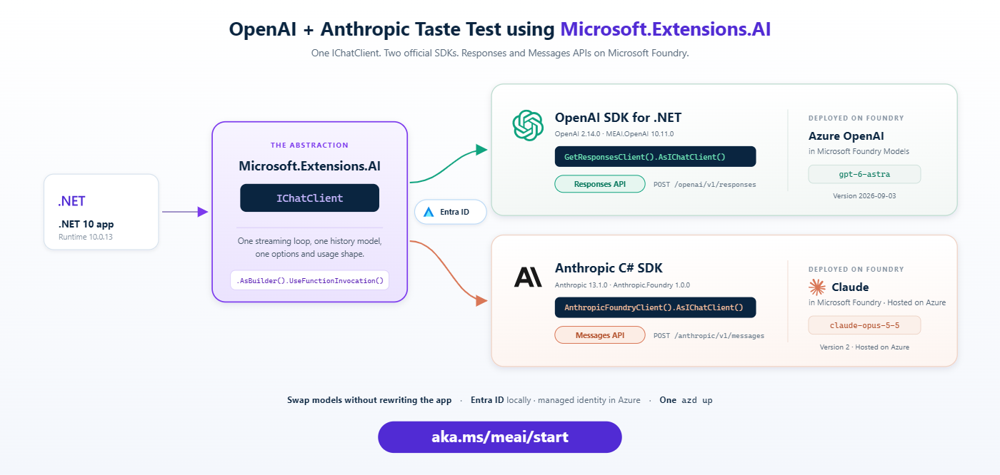
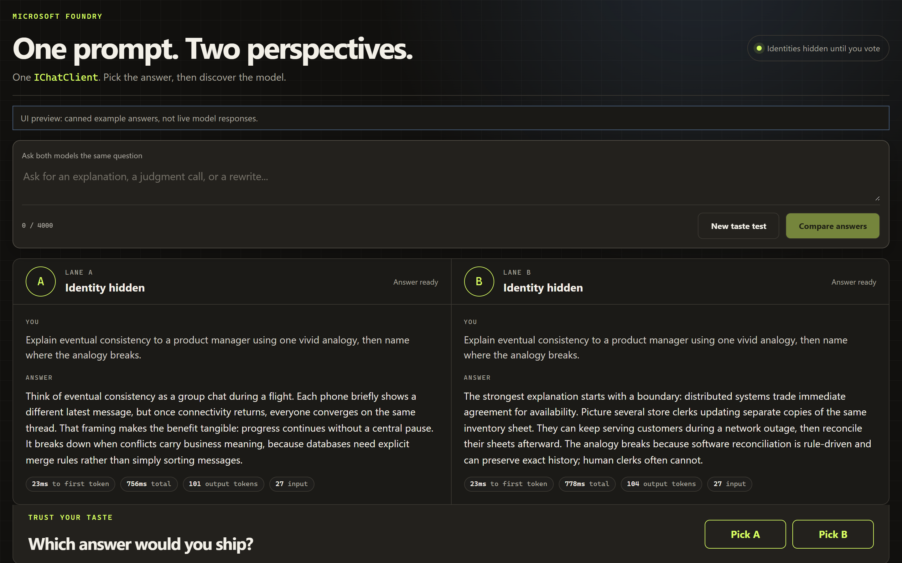

# OpenAI + Anthropic Taste Test using Microsoft.Extensions.AI

[](https://github.com/Azure-Samples/openai-anthropic-taste-test/actions/workflows/ci.yml)
[](LICENSE)
[](https://learn.microsoft.com/azure/developer/azure-developer-cli/)

Ask GPT and Claude the same question. Read both answers without knowing which is which. Vote. Then see who wrote what.

Underneath, it is one .NET interface — `IChatClient` — talking to two different vendor SDKs over two different wire protocols, both running on Microsoft Foundry.



## What you'll see

1. **Ask once.** You type one prompt. Both models answer at the same time.
2. **Stay blind.** The answers appear in two lanes named **A** and **B**. Nothing on the page says which model is which.
3. **Vote, then reveal.** Pick the answer you like. Only then does the app show the provider, model, SDK, and protocol behind each lane.

Live answers show time to first visible text, total time, and API-reported token counts through the same .NET types. Output token counts can include reasoning, not just the words on screen. Preview token counts are estimates.



## Try it now, no Azure needed

You only need the [.NET 10 SDK](https://dotnet.microsoft.com/download/dotnet/10.0).

```powershell
git clone https://github.com/Azure-Samples/openai-anthropic-taste-test
cd openai-anthropic-taste-test
dotnet run --project src/TasteTest --launch-profile sample
```

Open **http://localhost:5050**. This runs the real UI with canned answers, so you can see the whole flow before spending anything. The page tells you it is a preview.

## Deploy the real thing

One command provisions everything and deploys the app:

```powershell
azd auth login
azd up
```

`azd` asks you a few questions (subscription, region, environment name, and your organization name for the Anthropic offer), then prints a URL. Open it and you have a live taste test.

**What you need first**

| | |
|---|---|
| An Azure subscription | Must be allowed to buy Anthropic models from Azure Marketplace |
| Permission to create resources | `Owner`, or `Contributor` + `Role Based Access Control Administrator` |
| Model quota | Enough capacity for one GPT and one Claude deployment |
| Tools | [.NET 10 SDK](https://dotnet.microsoft.com/download/dotnet/10.0) and [Azure Developer CLI](https://learn.microsoft.com/azure/developer/azure-developer-cli/install-azd) 1.17+ |

Not every subscription can deploy Claude. CSP, free-trial, student, and some sponsored subscriptions are not eligible. See [Deploy and use Claude models in Microsoft Foundry](https://learn.microsoft.com/azure/foundry/foundry-models/how-to/use-foundry-models-claude).

When you're done, remove everything:

```powershell
azd down --purge --force
```

<details>
<summary><b>If you can't create role assignments</b></summary>

Hosting the app in Azure needs the `Microsoft.Authorization/roleAssignments/write` permission. `Contributor`, `Azure AI Developer`, and `Foundry Owner` do **not** include it. Ask your administrator for `Role Based Access Control Administrator` at subscription scope.

You don't have to wait. Local mode creates only the Foundry account and the two model deployments — no role assignments at all — and runs the app on your own machine under your own identity:

```powershell
azd env set HOSTING_MODE local
azd env set ASSIGN_INFERENCE_ROLE_TO_DEPLOYER false
azd provision
powershell.exe -NoProfile -ExecutionPolicy RemoteSigned -File .\scripts\run-local.ps1
```

Use `azd provision`, not `azd up`, because this mode deliberately deploys no Azure hosting. Your account still needs data access to Foundry, which `Azure AI Developer`, `Foundry Owner`, or `Cognitive Services User` provides.

Switch to full Azure hosting later without recreating anything:

```powershell
azd env set HOSTING_MODE containerapp
azd up
```

</details>

<details>
<summary><b>Deploy without any prompts</b></summary>

Once you've signed in once, you can supply every answer up front:

```powershell
azd env new taste-test `
  --subscription <subscription-id> `
  --location eastus2 `
  --no-prompt

azd env set AZURE_TENANT_ID <tenant-id>
azd env set CLAUDE_ORGANIZATION_NAME "<legal-entity>"
azd env set CLAUDE_COUNTRY_CODE US
azd env set CLAUDE_INDUSTRY technology
azd provision --preview --no-prompt
azd up --no-prompt
```

The organization name is legal attestation data for the Anthropic Marketplace offer. It is the only value the template will not guess for you.

</details>

<details>
<summary><b>Let an AI agent set it up for you</b></summary>

This repository ships an [Agent Skill](.github/skills/openai-anthropic-taste-test/SKILL.md) for GitHub Copilot CLI and compatible agents. From this folder, ask:

> Set up and verify the OpenAI + Anthropic taste test with the least manual intervention.

The agent reuses your cached sign-in, picks full Azure hosting or the no-role-assignment local mode based on what you're allowed to do, previews the infrastructure, deploys, tests both models, checks that the page really is blind, and tells you how to clean up.

</details>

## How it works

This is the part worth reading. Two vendors, two protocols, one application loop.

| Lane | Vendor SDK | Foundry route | Protocol |
|---|---|---|---|
| GPT | OpenAI SDK for .NET | `/openai/v1` | Responses API |
| Claude | Anthropic C# SDK | `/anthropic` | Messages API |

Each SDK is constructed its own way, using its own auth style. Both end as the same type:

```csharp
var credential = new DefaultAzureCredential();

IChatClient gpt = new OpenAIClient(
        new BearerTokenPolicy(credential, "https://ai.azure.com/.default"),
        new OpenAIClientOptions { Endpoint = new($"{endpoint}/openai/v1/") })
    .GetResponsesClient()
    .AsIChatClient(aoaiDeployment)
    .AsBuilder()
    .UseFunctionInvocation()
    .Build();

IChatClient claude = new AnthropicFoundryClient(
        new AnthropicFoundryIdentityTokenCredentials(credential, resourceName))
    .AsIChatClient(claudeDeployment)
    .AsBuilder()
    .UseFunctionInvocation()
    .Build();
```

There are no API keys. `BearerTokenPolicy` and `AnthropicFoundryIdentityTokenCredentials` both take the same Entra `TokenCredential` and refresh tokens on their own.

After that, nothing in the app knows which vendor it is talking to. The comparison loop is plain `Microsoft.Extensions.AI` code — same call, same options, same streaming type, for both lanes:

```csharp
var responses = await Task.WhenAll(lanes.Select(async lane =>
{
    var messages = new List<ChatMessage>(lane.History) { new(ChatRole.User, prompt) };
    var updates = new List<ChatResponseUpdate>();

    await foreach (var update in lane.Client.GetStreamingResponseAsync(
        messages,
        new ChatOptions { MaxOutputTokens = 4096 },
        cancellationToken))
    {
        updates.Add(update);
        lane.Buffer.Append(update.Text);
        await requestThrottledRender();
    }

    return updates.ToChatResponse();
}));
```

`ToChatResponse()` also folds each provider's usage reporting into one `UsageDetails`, which is why the page can show token counts for both lanes without any provider-specific code.

The OpenAI construction includes a small [completion adapter](src/TasteTest/Services/OpenAIStreamCompletionClient.cs): MEAI.OpenAI 10.9.0 forwards `response.incomplete` without its finish reason or usage. The adapter uses the SDK's native response conversion to preserve both, without duplicating streamed text. The shared application loop stays provider-neutral.

Swapping either lane for a different model is a configuration change, not a rewrite.

<details>
<summary><b>What this sample does not do</b></summary>

Being precise so nothing here is oversold:

- `UseFunctionInvocation()` installs MEAI's tool-calling middleware, but this sample registers **no tools**, so no tool call is executed.
- It does not request structured output.
- It does not reuse provider-side conversation IDs. Every turn replays the full completed history to both lanes.
- Canceled, failed, truncated, and empty answers cannot win a vote. Voting stays disabled with an explanation until both answers complete. **Retry comparison** resends the last prompt to both lanes. Earlier attempts remain visible but are excluded from future context.
- Each lane has a 120-second deadline. Cancel stops both lanes; neither an abandoned comparison nor a failed follow-up changes completed conversation history.

</details>

## What `azd up` creates

| Resource | Why |
|---|---|
| Microsoft Foundry account and project | One endpoint for both model families |
| `gpt-5.6-sol` deployment | The OpenAI Responses lane |
| `claude-opus-5` (version 2, Hosted on Azure) | The Anthropic Messages lane |
| Azure Container App | Runs the Blazor Server app |
| User-assigned managed identity | Lets the app reach Foundry without secrets |
| Azure Container Registry | Stores the image built by `azd deploy` |
| Log Analytics workspace | Collects platform and application logs |

## Run against your deployed models

After `azd provision`, run the app on your machine against the real Foundry endpoint:

```powershell
powershell.exe -NoProfile -ExecutionPolicy RemoteSigned -File .\scripts\run-local.ps1
```

```bash
./scripts/run-local.sh
```

Both open **http://localhost:5050**, load your active `azd` environment, turn off canned answers, and sign in with the Azure credential you already have. A separate `az login` is not required if you have a usable cached credential.

The Windows command allows local scripts for that process only; it does not permanently change your execution policy. Organization-enforced policies still apply.

Before a demo, run a real comparison, vote, and ask a follow-up. The no-Azure preview does **not** verify model access or live inference.

<details>
<summary><b>Use different models</b></summary>

Defaults, current as of September 2, 2026:

| Setting | Default |
|---|---|
| `CLAUDE_MODEL_NAME` | `claude-opus-5` |
| `CLAUDE_MODEL_VERSION` | `2` (Hosted on Azure) |
| `CLAUDE_MODEL_CAPACITY` | `25` |
| `AOAI_MODEL_NAME` | `gpt-5.6-sol` |
| `AOAI_MODEL_VERSION` | `2026-07-09` |
| `AOAI_MODEL_CAPACITY` | `10` |
| `TASTE_TEST_MAX_OUTPUT_TOKENS` | `4096` |

This budget covers reasoning as well as visible answers. The old 900-token budget could be exhausted before any text appeared. If an existing environment still sets that value, update it and restart the local app:

```powershell
azd env set TASTE_TEST_MAX_OUTPUT_TOKENS 4096
```

For Azure hosting, preview and provision again to update the app setting.

A faster, cheaper pair for rehearsals:

```powershell
azd env set CLAUDE_MODEL_NAME claude-sonnet-5
azd env set CLAUDE_MODEL_VERSION 2
azd env set AOAI_MODEL_NAME gpt-5.4-mini
azd env set AOAI_MODEL_VERSION 2026-03-17
azd provision
azd deploy
```

Check model versions, regions, and quota in the Foundry model catalog before changing these.

</details>

<details>
<summary><b>What it costs</b></summary>

You pay for model tokens, Azure Container Registry (Basic), Container Apps compute, and Log Analytics ingestion. The default keeps one replica warm so a live demo never cold-starts.

For non-demo environments, let it scale to zero:

```powershell
azd env set CONTAINER_MIN_REPLICAS 0
azd provision
```

</details>

<details>
<summary><b>Security</b></summary>

- Key-based authentication is disabled on the Foundry account.
- No API keys or connection strings exist in the repo or in app settings.
- The Container App uses a user-assigned managed identity with `Cognitive Services User`.
- That same identity gets only `AcrPull` on the container registry.
- Prompts stay in server-side Blazor circuit state and go straight to the model endpoints.
- Markdown headings, lists, emphasis, and code are rendered safely. Raw HTML is escaped, and model-generated links and images are inert text.

</details>

<details>
<summary><b>SDK version pinning</b></summary>

Verified September 7, 2026: `Microsoft.Extensions.AI.OpenAI` 10.9.0 requires `OpenAI >= 2.12.0 && < 2.13.0`, so this template pins `OpenAI` 2.12.0 even though 2.13.0 exists. `Anthropic` is pinned to 12.46.0 rather than floating. `Anthropic.Foundry` has its own version (`0.7.1`) and does not track the `Anthropic` package version.

If your package mirror lags, use NuGet.org or ask the mirror owner to sync those versions.

</details>

<details>
<summary><b>Troubleshooting</b></summary>

**GPT deployment fails with insufficient quota.** Lower `AOAI_MODEL_CAPACITY`, pick another region, use a smaller model, or request quota in the Azure portal.

**Claude deployment is rejected.** Check subscription Marketplace eligibility, your organization metadata, and that you're using a Hosted on Azure model version.

**One lane returns 403.** Role assignments can take a few minutes to propagate after the first deploy. Confirm the app identity has `Cognitive Services User` on the Foundry account, then restart the Container App revision.

**Blank or cut-off answer; voting disabled.** Check the lane's message. A reasoning model can consume its output budget without producing text. Use the 4096-token default, restart the app after changing settings, and retry. Both lanes must finish before voting; the successful answer isn't itself incomplete when the other lane fails.

**A request seems stuck.** The button changes to **Generating...**, a status message explains the wait, and **Cancel** remains available. A lane that exceeds 120 seconds fails with a retry message instead of waiting indefinitely.

**PowerShell says scripts are disabled.** Use the process-scoped Windows command in "Run against your deployed models." If an organizational policy still blocks execution, ask your administrator for the approved approach.

**Provisioning fails with `Authorization failed ... roleAssignments/write`.** You can create resources but not role assignments. Either ask for `Role Based Access Control Administrator` at subscription scope, or use local mode: `azd env set HOSTING_MODE local`, `azd env set ASSIGN_INFERENCE_ROLE_TO_DEPLOYER false`, then `azd provision` and the Windows launcher above.

**Claude deployment fails with `no valid payment method`.** Marketplace rejected the subscription for that offer. Confirm eligibility with your subscription administrator. Pointing `CLAUDE_MODEL_NAME` at an OpenAI model does not work around this — that lane always deploys an Anthropic model.

**Streaming disconnects after scaling.** This template fixes the Container App at one replica because Blazor Server circuit state lives in memory. Add Azure SignalR Service and distributed state before raising `maxReplicas`.

</details>

## Verify your changes

```powershell
dotnet test OpenAIAnthropicTasteTest.slnx
azd provision --preview
```

The tests cover concurrent streaming, blocking SDK startup, usage and latency, guarded voting, winner-only continuation, cancellation, timeouts, retry isolation, truncated/empty streams, and safe Markdown. Transport tests exercise the actual SDKs with native JSON and server-sent events, without calling Azure.

## Learn more

- [Claude models in Microsoft Foundry](https://learn.microsoft.com/azure/foundry/foundry-models/concepts/claude-models)
- [Deploy and use Claude models](https://learn.microsoft.com/azure/foundry/foundry-models/how-to/use-foundry-models-claude)
- [OpenAI .NET SDK](https://github.com/openai/openai-dotnet)
- [Anthropic C# SDK](https://github.com/anthropics/anthropic-sdk-csharp)
- [Microsoft.Extensions.AI](https://learn.microsoft.com/dotnet/ai/microsoft-extensions-ai)

## Contributing

Contributions and suggestions are welcome. See [CONTRIBUTING.md](CONTRIBUTING.md).

## License

[MIT](LICENSE)
